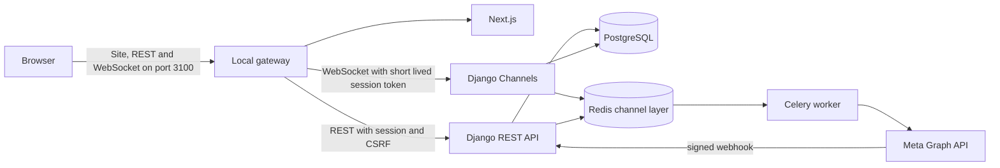

# Architecture

The database is the durable source of truth. Redis distributes real time events and queues background jobs. Message sending uses client supplied UUID idempotency keys and server generated UUID message IDs. WhatsApp outgoing messages are first committed to a database outbox. A transport timeout leaves the job `uncertain` for manual reconciliation rather than blindly resending. Incoming webhooks are HMAC verified and stored in an inbox keyed by a payload digest before processing.

Internal and WhatsApp conversations have different capabilities. Internal messages can be edited and reacted to. WhatsApp sends are limited to supported text and approved templates, with a customer service window and opt-in checks. Internal stories never publish to WhatsApp Status.

This is a modular monolith. The backend currently uses one Django `core` app with separate serializer, API, task, WebSocket and WhatsApp modules. Splitting domains into distinct Django apps is a future refactor after the contracts stabilize.
