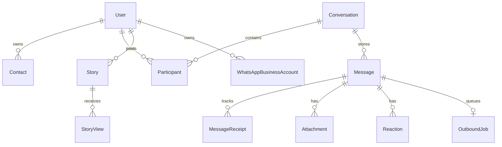

# Database

The initial and second migrations are in `backend/core/migrations/`. UUIDs identify users, conversations and messages. Uniqueness constraints cover participant membership, per sender client message keys, reactions, story views, template locale, and webhook payload digests.

Conversation activity and message creation times are indexed. WebhookEvent holds the signed webhook body after validation for retry. The account access token is never stored in the database.
